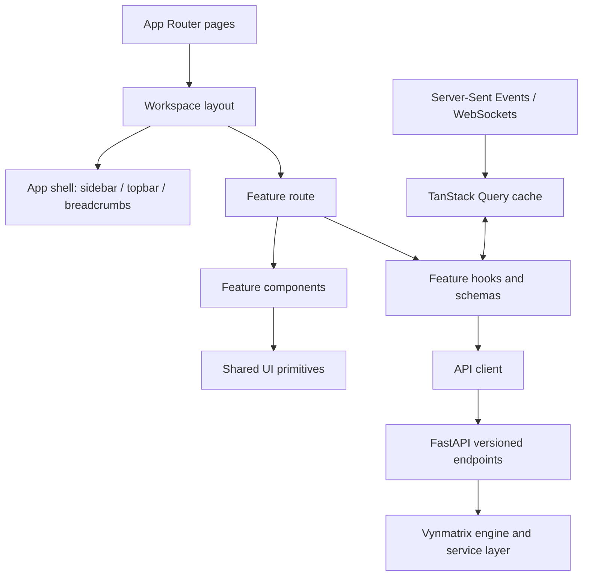

# Vynmatrix Frontend Template

A UI-only starter for a self-hosted quantitative strategy platform. It demonstrates the main navigation, dashboard, strategy list and builder, backtest history, ML lab, paper trading, market-data inventory, audit timeline, and settings.

> **Important:** Every number, strategy, order, model metric, and event currently shown is fictional sample data. Buttons that are not explicitly functional are visual UI placeholders. No broker is connected, no order is sent, and no backend or authentication is included.

## 1. Recommended stack

| Layer | Recommended choice | Why |
|---|---|---|
| Web application | Next.js App Router + React + TypeScript | File-system routes, nested layouts, typed components, server/client component separation |
| Styling / design system | Tailwind CSS + shadcn/ui (recommended production option) | Consistent accessible controls that can be customized locally |
| Icons | lucide-react | Consistent line icon set |
| Charts | TradingView Lightweight Charts for candles/price panels; ECharts for richer analytics | Different needs for market-price charts vs performance/metrics visualizations |
| Python editor | `@monaco-editor/react` loaded client-side | Editor experience similar to VS Code; keep server-side validation authoritative |
| Server-state cache | TanStack Query | API caching, loading/error states, invalidation and polling |
| Local UI state | Zustand, used sparingly | Small cross-page client state such as UI preferences; avoid duplicating API state |
| Validation / forms | Zod + React Hook Form | Typed client validation; must mirror important validation on server |
| API | Existing Python engine behind FastAPI | Preserve engine business logic; UI talks to a versioned API rather than importing engine internals |
| Streaming | Server-Sent Events initially; WebSockets where bidirectional real-time control is needed | Session status, fills, progress, logs, alerts |

The starter uses custom CSS and Lucide so it is easy to inspect without requiring a shadcn component-generation step. It includes the chart/editor/query libraries in `package.json` as planned integrations, but the demo screens do not yet use those integrations.

## 2. Run locally

Requirements: Node.js 20.9+ (prefer current Node.js LTS) and npm.

```bash
npm install
cp .env.example .env.local
npm run dev
```

On Windows PowerShell, copy the example environment file with:

```powershell
Copy-Item .env.example .env.local
npm install
npm run dev
```

Open `http://localhost:3000`. The home route redirects to `/overview`.

## 3. Route map

| Route | Purpose |
|---|---|
| `/overview` | Workspace summary, mock portfolio chart, strategy health, audit preview |
| `/strategies` | Strategy inventory, status, versions, starter templates |
| `/strategies/new` | Strategy metadata, Python draft editor, checklist, AI-assistant placeholder |
| `/backtests` | Backtest history and result summary |
| `/ml-lab` | Model registry, experiment workflow, quality metrics |
| `/paper-trading` | Paper sessions, simulated orders, execution status |
| `/market-data` | Data-source and dataset inventory |
| `/activity` | Audit/feedback timeline |
| `/settings` | Workspace, API and default-risk configuration UI |

## 4. Frontend source layout

```text
src/
  app/
    layout.tsx                  # Root document + global styles + metadata
    page.tsx                    # Redirects to /overview
    globals.css                 # Design tokens, layout, responsive rules
    (workspace)/
      layout.tsx                # Shared authenticated-workspace shell
      overview/page.tsx
      strategies/page.tsx
      strategies/new/page.tsx
      backtests/page.tsx
      ml-lab/page.tsx
      paper-trading/page.tsx
      market-data/page.tsx
      activity/page.tsx
      settings/page.tsx
  components/
    app-shell.tsx               # Sidebar, active navigation, topbar, mobile nav
    ui.tsx                      # PageHeader, Panel, MetricCard, StatusBadge
  lib/
    mock-data.ts                # Replace with typed API responses/hooks
```

Recommended next refactor after connecting the API:

```text
src/
  app/                          # Routes and route-level loading/error boundaries
  components/
    layout/                     # Sidebar, topbar, breadcrumbs, workspace switcher
    ui/                         # Shared primitives and design system
    charts/                     # Equity curve, drawdown, OHLCV chart, indicator overlays
    tables/                     # Orders, fills, trades, model registry, audit events
    strategy/                   # Strategy editor, parameters, validation results
    backtest/                   # Run config, progress, metrics, trade analysis
    paper/                      # Sessions, orders, positions, risk events
  features/
    strategies/                 # API hooks + schemas + types + feature components
    backtests/
    models/
    paper-trading/
    market-data/
    audit/
    settings/
  lib/
    api-client.ts               # Centralized fetch wrapper, auth/session handling
    query-client.ts             # TanStack Query configuration
    permissions.ts              # UI permission helpers (never a server security boundary)
    formatters.ts               # Currency, percentages, timestamps, quantities
  types/
    api.ts                       # DTOs matching the backend's API contract
```

Use feature folders when a module grows. Do not create a global component for every one-off element; promote a component to `components/ui` only when it has a stable reusable contract.

## 5. Complete UI architecture



### Rendering and data ownership

- Keep mostly static page shells, headings, and layout in Server Components where possible.
- Use Client Components only when interaction requires them (editors, filters, interactive charts, modal flows, and real-time controls).
- Lazy-load Monaco and charting packages with a client-only boundary. Lightweight Charts is browser/client-side and should not be initialized during server rendering.
- Treat TanStack Query as the owner of remote API data; do not mirror the same data in Zustand. Reserve Zustand for genuinely shared local UI state.
- Establish loading skeletons, empty states, permission-denied states, stale-data indicators, retry actions, and error boundaries for every major route.
- Use URL query parameters for shareable filters such as instrument, timeframe, status, date range, and page number.

### API boundary

Use a versioned backend contract, for example:

- `GET /api/v1/strategies`, `POST /api/v1/strategies`, `GET /api/v1/strategies/{id}/versions`
- `POST /api/v1/backtests`, `GET /api/v1/backtests/{run_id}`, `GET /api/v1/backtests/{run_id}/trades`
- `GET /api/v1/models`, `POST /api/v1/experiments`
- `GET /api/v1/paper/sessions`, `POST /api/v1/paper/sessions`, `POST /api/v1/paper/sessions/{id}/pause`
- `GET /api/v1/paper/orders`, `GET /api/v1/paper/fills`
- `GET /api/v1/market-data/datasets`, `GET /api/v1/audit/events`

These are suggested frontend contracts, not claims that the endpoints already exist in Vynmatrix. Align names, request/response schemas and state transitions with the backend implementation before wiring the UI.

## 6. Critical safety boundaries

1. The browser is never the authority for whether an order may execute. The backend must independently verify user/workspace ownership, strategy version, environment, instrument, currency/FX, market session, risk limits, and all other execution constraints.
2. Do not send arbitrary user Python code to the API process for execution. Use isolated workers with CPU/memory/time/resource restrictions and default-deny network access.
3. Never expose broker credentials, provider API secrets, signing keys, or database credentials through `NEXT_PUBLIC_*` variables.
4. A frontend “Validate” button is only a request to backend validation. Local validation is useful feedback, not a security boundary.
5. Show paper/live environment context persistently; separate paper mode from any future live-trading flow with explicit authorization and server-enforced controls.
6. Store event IDs and link signals, scoring decisions, outbox commands, canonical orders, fills, and feedback in backend records. The frontend should display this trace rather than derive order state locally.
7. Show metrics with definitions and data windows. Label illustrative or incomplete data; do not show model confidence or backtest performance as guaranteed returns.

## 7. Build sequence

1. Replace mock data with TypeScript DTOs generated from or manually aligned to the API schemas.
2. Implement centralized API client, authentication/session handling, TanStack Query, and consistent error handling.
3. Complete strategy CRUD/versioning and backend validation.
4. Connect backtest submission, progress updates, run details, and trade-level results.
5. Connect paper sessions, orders/fills, risk rejections, and audit traceability.
6. Add ML experiments and data-source management after their API/data contracts stabilize.
7. Add accessibility, tests, audit events, secure deployment configuration, and operational monitoring.

## 8. Frontend tests to add

- Unit: formatters, strategy form schemas, risk-setting field validation.
- Component: empty/loading/error/table filters/editor dirty state.
- Integration: create a draft → validate → start a backtest → inspect results.
- Integration: start a paper session → receive an order event → show fill/rejection from server records.
- E2E: environment banner is always visible; destructive controls require confirmation; failed API calls never show a false success state.
